<p align="center" style="display: flex">

<span style="margin: auto; font-size: 500%">Diary</span>
</p>

<p align="center">
<a href="https://github.com/Ruslan131132/project_laravel"></a>
</p>

## Electronic Diary

Electronic Diary is a Laravel web application for students and teachers that simplifies everyday school workflows.
The project keeps the original Russian UI and interaction style while providing a professional Docker-based setup for local runs.

### Features

- View class schedules
- View academic performance (marks)
- Enroll in clubs / extracurricular courses
- Upload and store user avatars on the server
- Create / update / delete marks
- Create / edit / delete schedules per class
- Manage student / teacher / class data from the admin panel

### Roles

| Role | `user_type` value | Access |
|------|-------------------|--------|
| Administrator | `Администратор` | Admin panel |
| Teacher | `Учитель` | User cabinet (schedule, marks, courses) |
| Student | `Ученик` | User cabinet (schedule, marks, courses) |

Login uses a numeric **user ID** (not email).

---

## Quick start with Docker

### Requirements

- Docker Desktop (or Docker Engine + Compose v2)

### Run

```bash
docker compose up -d --build
```

The app will:

1. Install Composer dependencies
2. Generate `APP_KEY` if needed
3. Wait for MySQL
4. Run migrations
5. Seed demo data
6. Create the storage symlink

Open: [http://localhost:8088](http://localhost:8088)

Useful commands:

```bash
make up          # build & start
make logs        # follow container logs
make fresh       # migrate:fresh --seed
make down        # stop stack
```

---

## Demo accounts

Password for all seeded users: `password`

| Role | User ID | Notes |
|------|---------|-------|
| Administrator | `1000000001` | Full admin access |
| Teacher | `1000000002` | Homeroom teacher of class 9А |
| Teacher | `1000000003` | Homeroom teacher of class 10Б |
| Teacher | `1000000004` | Subject teacher / course mentor |
| Student | `1000000011` | Class 9А |
| Student | `1000000014` | Class 10Б |

Seeded data also includes days, lessons, cabinets, subjects, schedules, marks, and sample courses.

---

## Manual setup (without Docker)

```bash
cp .env.example .env
# Point DB_* to your local MySQL instance
composer install
php artisan key:generate
php artisan migrate --seed
php artisan storage:link
php artisan serve
```

---

## Stack

- **Laravel** 8.x
- **PHP** 8.0
- **MySQL** 8.0
- **Nginx** + PHP-FPM (Docker)
- **Bootstrap** 5.1.3
- **jQuery** 3.5.1

Originally developed on macOS with XAMPP / PhpStorm as an exam project for Moscow Polytechnic University.

---

## Project structure

```text
app/Http/Controllers/Admin   Admin panel (users, classes, schedule, ...)
app/Http/Controllers/User    Student / teacher cabinet
app/Models                   Domain models
database/migrations          Schema
database/seeders             Demo dataset
docker/                      Nginx + PHP entrypoint
resources/views              Blade templates (Russian UI)
public/                      Assets, demo screenshots, avatars
```

---

## Demo screenshots

> Home page

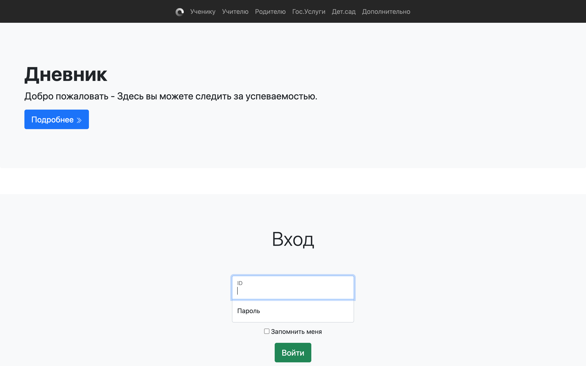

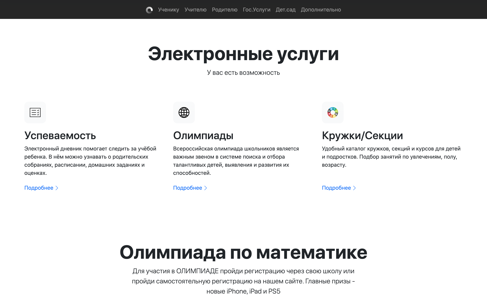

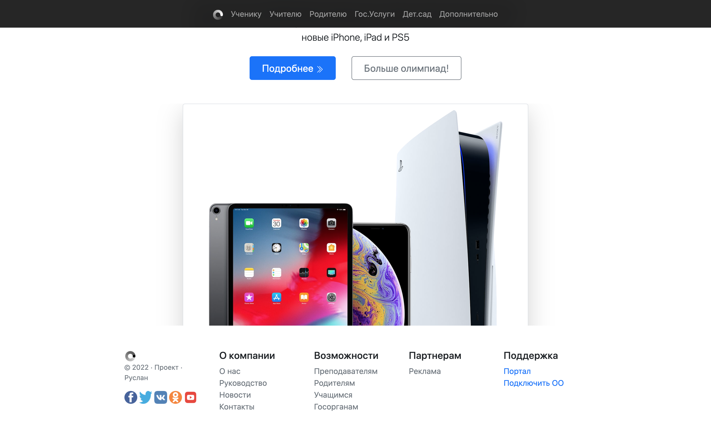

------------

> User cabinet (teacher example)

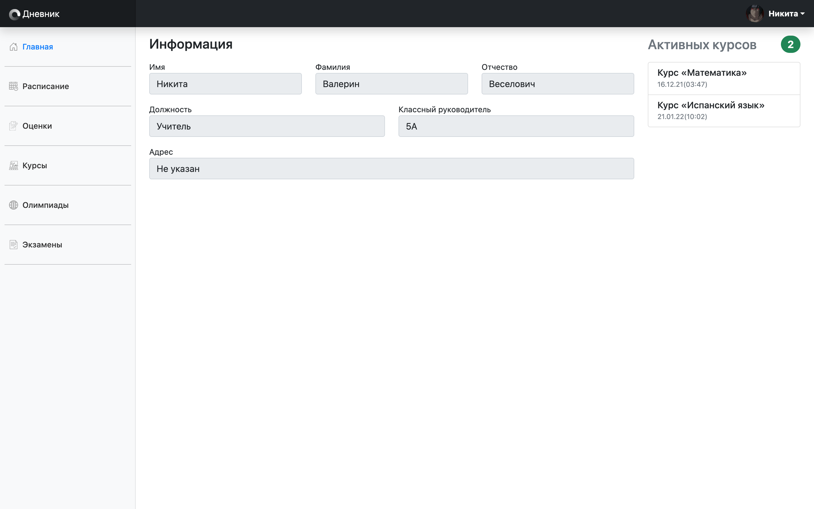

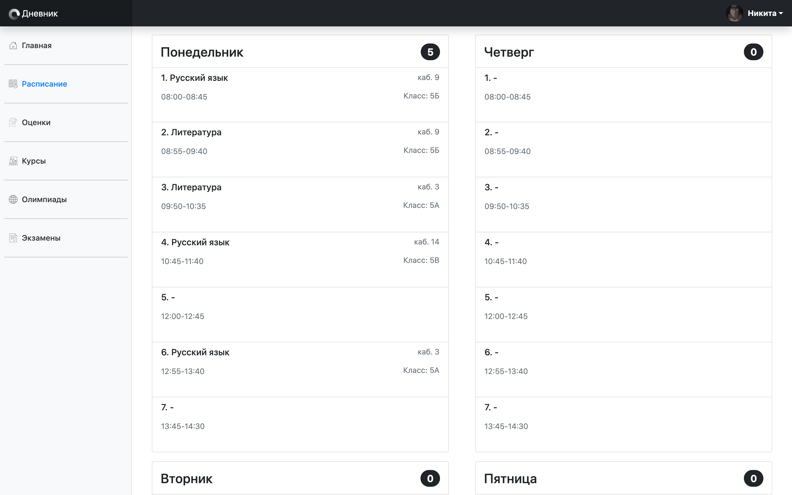

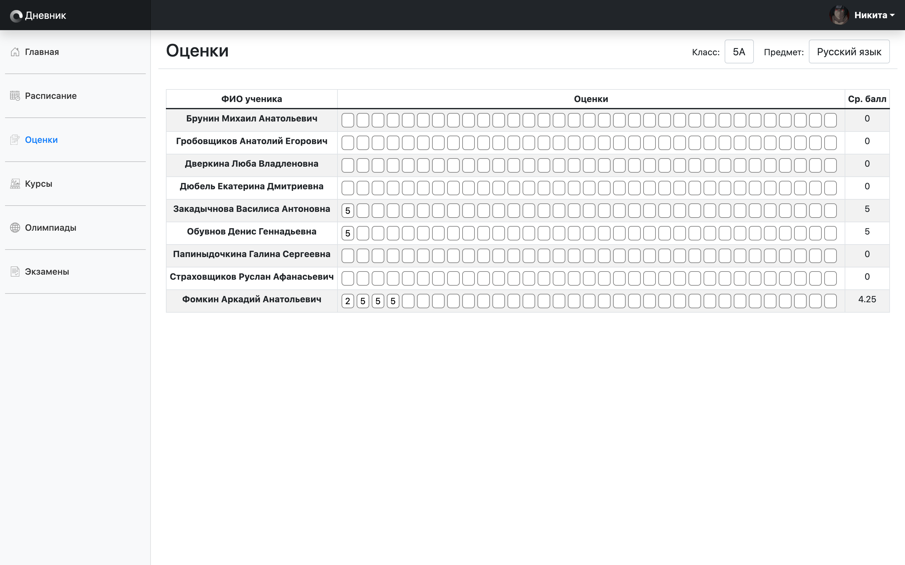

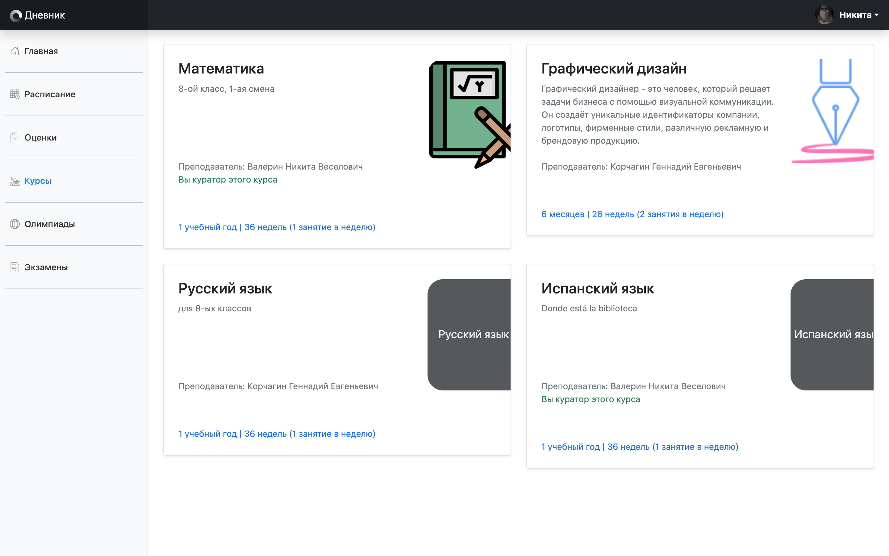

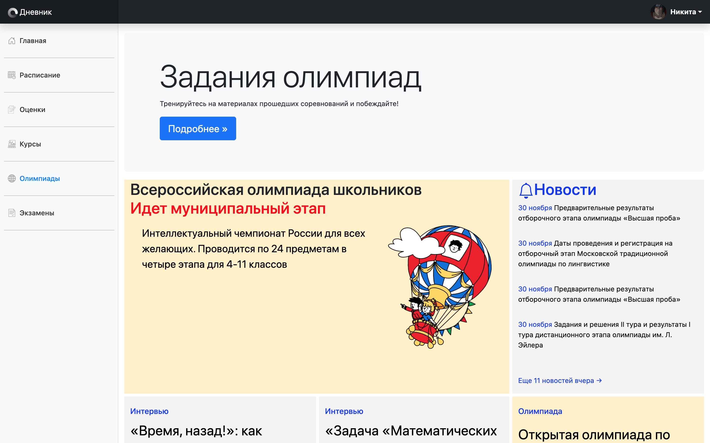

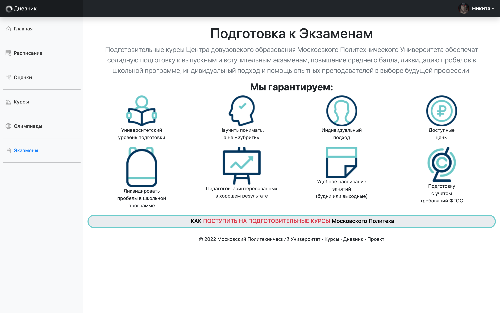

------------

> Admin panel

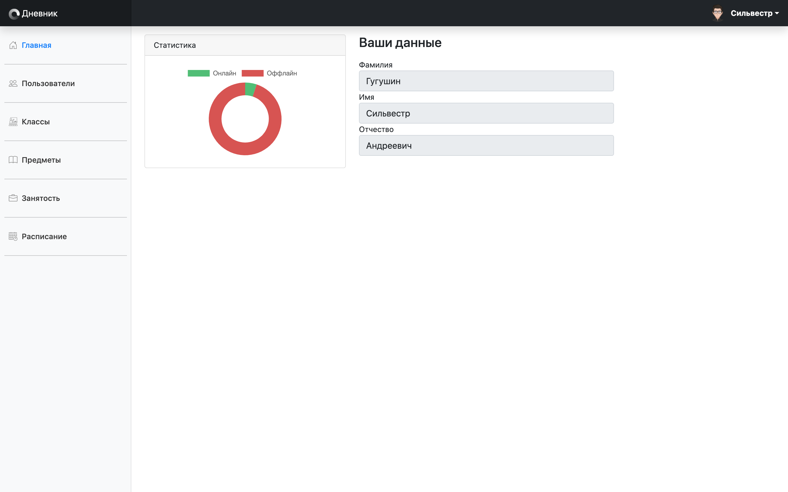

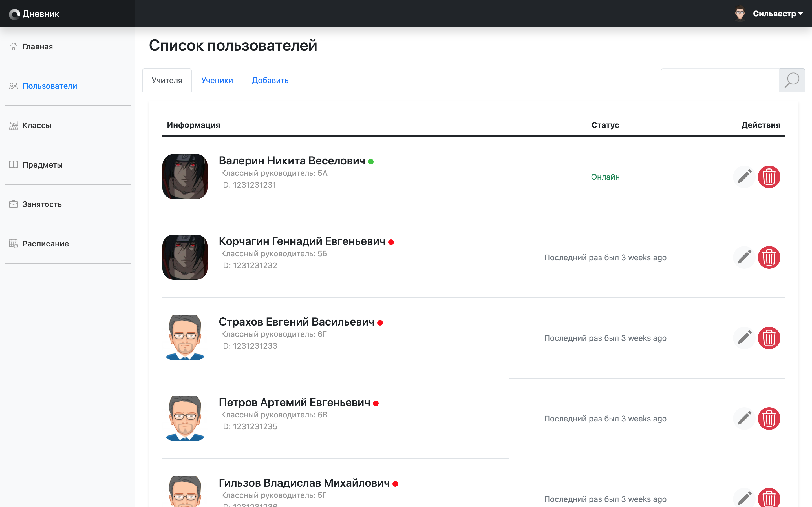

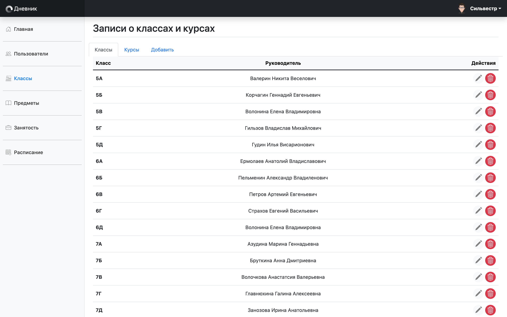

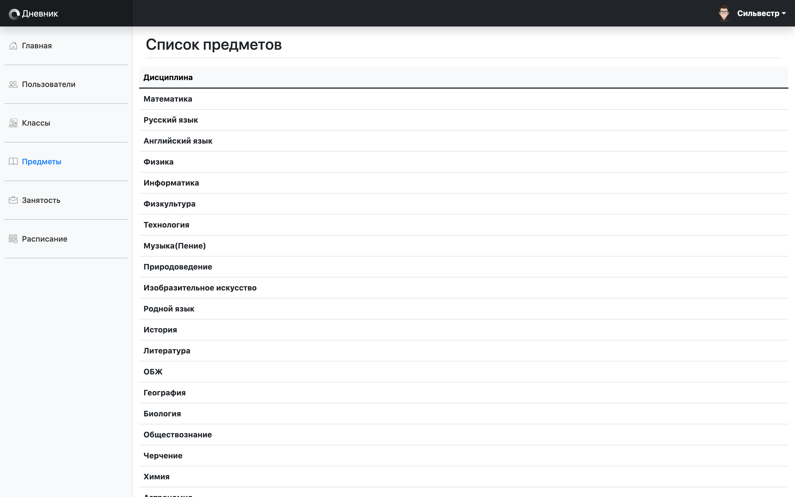

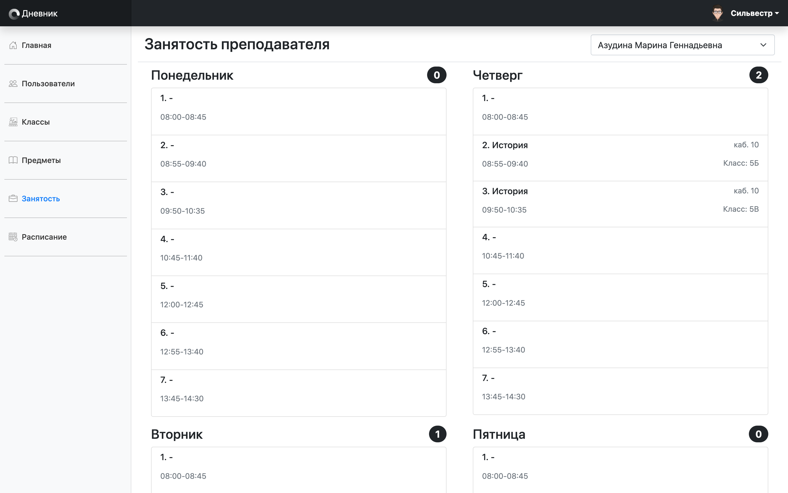

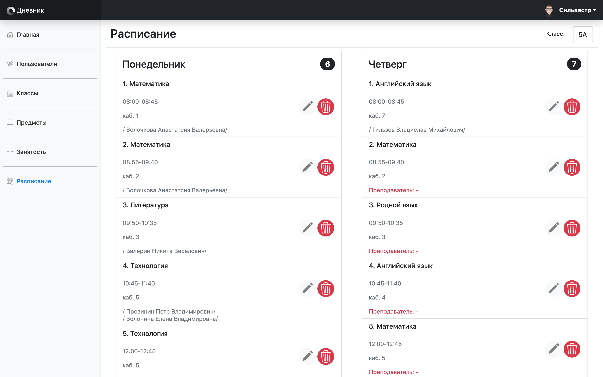
